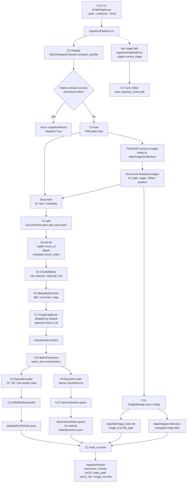
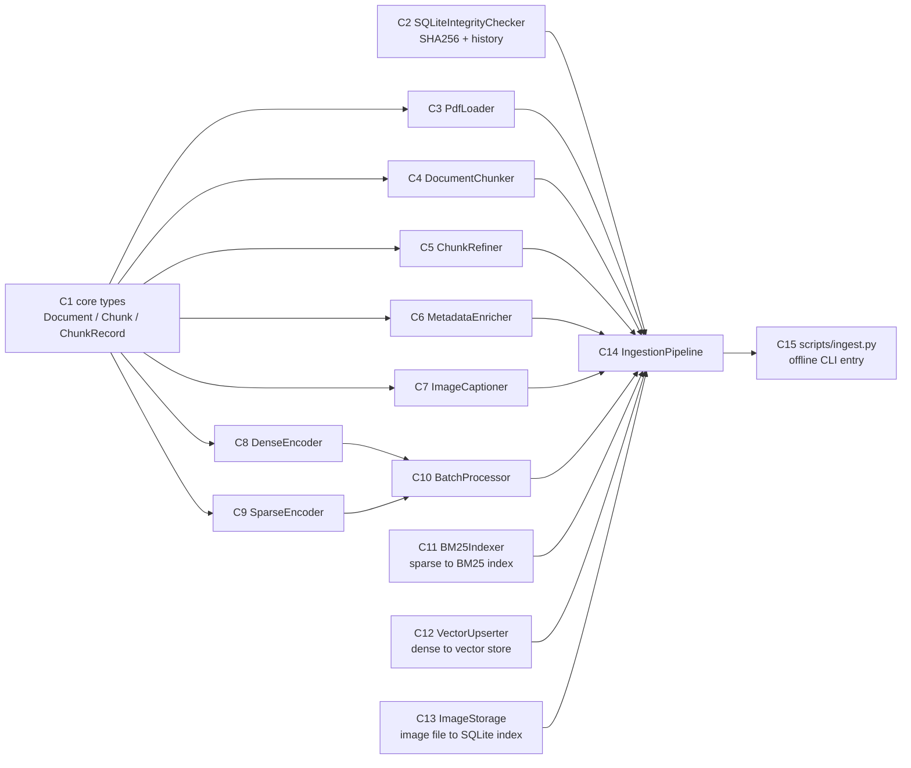

# C阶段说明：Ingestion Pipeline MVP

本文说明阶段 C 已实现的数据摄取链路。内容按当前代码实现整理，核心入口是 `src/ingestion/pipeline.py` 的 `IngestionPipeline.run()`，命令行入口是 `scripts/ingest.py`。

## 1. 阶段目标

阶段 C 的目标是把 PDF 文档离线摄取成本地可检索资产：

- 文本资产：PDF -> `Document` -> `Chunk` -> refined/enriched chunks。
- 稀疏检索资产：chunks -> sparse term statistics -> BM25 倒排索引。
- 向量检索资产：chunks -> dense vectors -> vector store upsert。
- 图片资产：PDF 中抽取的图片 -> `data/images/{collection}/` + SQLite 索引。
- 增量控制：通过 SHA256 和 ingestion history 避免未变更文件重复摄取。

## 2. 整体流程图

### 2.1 实际运行时流程

这张图按 `IngestionPipeline.run()` 的真实执行顺序画。注意：PDF 图片文件是在 `PdfLoader` 阶段由 PyMuPDF 抽取并写入 `data/images/{collection}/` 的，后面的 `ImageStorage` 主要负责把这些图片纳入 SQLite 索引；如果源路径和目标路径不同，也会复制到托管目录。



### 2.2 C1-C15 模块关系图

这张图按阶段 C 的代码模块依赖来画，方便看每个子阶段在整条链路中的位置。



## 3. 数据契约

阶段 C 的所有模块围绕 `src/core/types.py` 的三个核心类型传递数据：

- `Document`：Loader 输出的完整文档，字段是 `id`、`text`、`metadata`。PDF 的 `metadata` 会包含 `source_path`、`doc_hash`、`page_count`、`images`。
- `Chunk`：切分后的文本块，字段是 `id`、`text`、`metadata`、`start_offset`、`end_offset`、`source_ref`。`metadata.chunk_index` 用于后续稳定向量 id。
- `ChunkRecord`：存储和检索载体，字段是 `id`、`text`、`metadata`、`dense_vector?`、`sparse_vector?`。Dense 和 Sparse 编码都输出这个结构。

这样做的好处是每一步只依赖明确对象，不直接传裸 dict，便于验证和测试。

## 4. 分阶段实现说明

### 4.1 integrity：文件完整性检查

代码位置：`src/libs/loader/file_integrity.py`

使用 `SQLiteIntegrityChecker`：

- `compute_sha256(path)` 按 1MB 分块读取文件，计算 SHA256。
- `should_skip(file_hash)` 查询 `data/db/ingestion_history.db`，如果同 hash 已经 `success`，且本次没有 `force=True`，pipeline 直接返回 `skipped=True`。
- `mark_success()` 和 `mark_failed()` 用 SQLite 记录摄取结果。
- SQLite 启用 `PRAGMA journal_mode=WAL`，支持并发写入场景。

这个阶段决定了重复运行是否跳过，是 C15 CLI 重复运行 skip 的基础。

### 4.2 load：PDF 解析和图片抽取

代码位置：`src/libs/loader/pdf_loader.py`

使用 `PdfLoader.load(path)`：

- 通过 PyMuPDF (`fitz`) 打开 PDF。
- 每页使用 `page.get_text("text")` 抽取文本。
- 每页使用 `page.get_images(full=True)` 找图片。
- 图片 id 采用 `{doc_hash}_{page_index}_{image_index}`。
- 文本中插入统一占位符：`[IMAGE: image_id]`。
- 图片文件保存到 `image_output_dir / collection / {image_id}.png`。
- `Document.metadata.images` 记录图片 id、path、page、text_offset、text_length、position。

Pipeline 默认创建 `PdfLoader` 时，会把 `image_output_dir` 指向 `ImageStorage.image_root`，保证 loader 抽出来的图片路径和后续图片索引使用同一个根目录。

### 4.3 split：Document 到 Chunk

代码位置：`src/ingestion/chunking/document_chunker.py`

使用 `DocumentChunker.split_document(document)`：

- 内部调用 `libs.splitter.SplitterFactory` 创建 splitter。
- 默认补齐配置是 `retrieval.splitter.provider=recursive`。
- `RecursiveSplitter` 使用 LangChain 的 `RecursiveCharacterTextSplitter`。
- chunk id 生成方式是 `{doc_id}_{index:04d}_{sha256(chunk_text)[:8]}`，同一文档和同一文本会得到稳定 id。
- 用 `_locate_chunk_offsets()` 回填 `start_offset/end_offset`。
- 继承 `Document.metadata`，并增加 `metadata.chunk_index`。
- 如果 chunk 文本中包含 `[IMAGE: ...]`，只把对应图片 metadata 分发到该 chunk，避免所有 chunk 都带全量图片列表。

这一层是业务适配器：底层 splitter 只负责切文本，DocumentChunker 负责把切分结果变成项目统一的 `Chunk`。

### 4.4 transform：文本清洗、元数据增强、图片 caption 标记

代码位置：

- `src/ingestion/transform/chunk_refiner.py`
- `src/ingestion/transform/metadata_enricher.py`
- `src/ingestion/transform/image_captioner.py`

Pipeline 默认按顺序执行三个 transform：

1. `ChunkRefiner`
   - 默认规则清洗，不启用 LLM。
   - 去掉常见噪声、页眉页脚、HTML 注释、分隔线等。
   - 保留 code fence 内容。
   - 写入 `metadata.refined_by`。

2. `MetadataEnricher`
   - 默认规则增强，不启用 LLM。
   - 生成 `title`、`summary`、`tags`。
   - 空文本或异常时使用 fallback 元数据。
   - 写入 `metadata.metadata_enriched_by`。

3. `ImageCaptioner`
   - 当前配置默认 `enabled: false`。
   - 如果 chunk 有图片引用但未启用 Vision LLM，会保留图片引用并写入 `has_unprocessed_images=True`、`image_caption_status=disabled`。
   - 如果后续启用 Vision LLM，会调用 `BaseVisionLLM.chat_with_image()`，把 caption 写回 `metadata.image_captions` 和 `metadata.images[].caption`。

这三个 transform 都遵循 `BaseTransform.transform(chunks)` 风格，输入输出仍然是 `list[Chunk]`。

### 4.5 encode：批处理、Dense、Sparse

代码位置：

- `src/ingestion/embedding/batch_processor.py`
- `src/ingestion/embedding/dense_encoder.py`
- `src/ingestion/embedding/sparse_encoder.py`

使用 `BatchProcessor.process(chunks)`：

- 按 `batch_size` 稳定切批，默认从 `ingestion.batch_processor.batch_size` 读取。
- 每批同时调用 `DenseEncoder.encode()` 和 `SparseEncoder.encode()`。
- 最后把各批 dense records 展平，把 sparse stats 合并成全局统计。

Dense 路径：

- `DenseEncoder` 调用 `EmbeddingFactory` 或注入的 embedding provider。
- 输出 `ChunkRecord(..., dense_vector=[...])`。
- 校验向量数量必须等于 chunk 数量，所有向量维度一致，且元素都是数字。

Sparse 路径：

- `SparseEncoder` 用正则 `TOKEN_RE = [A-Za-z0-9_]+` 分词。
- 小写归一化，支持 `min_token_length`。
- 每个 chunk 输出 term frequency：`sparse_vector={term: tf}`。
- 全局输出 `corpus_stats`：`doc_count`、`avg_doc_length`、`document_frequency`、`doc_lengths`。

### 4.6 store_bm25：BM25 倒排索引

代码位置：`src/ingestion/storage/bm25_indexer.py`

使用 `BM25Indexer.build(sparse_result)`：

- 从 `SparseEncodingResult.records` 和 `corpus_stats.doc_lengths` 构建倒排索引。
- IDF 公式按 spec 实现：

```text
idf(term) = log((N - df + 0.5) / (df + 0.5))
```

- 索引结构：

```python
{
    "term": {
        "idf": float,
        "postings": [
            {"chunk_id": str, "tf": float, "doc_length": int}
        ]
    }
}
```

- 默认持久化到 `data/db/bm25/index.json`。
- 支持 `load()`、`from_disk()`、`query()`、`rebuild()`、`update()`。
- `update()` 的实现是按 chunk id 替换/新增记录，然后整体重算 DF/IDF，避免增量更新导致统计漂移。

### 4.7 store_vectors：向量写入

代码位置：`src/ingestion/storage/vector_upserter.py`

使用 `VectorUpserter.upsert(dense_records)`：

- 输入是带 `dense_vector` 的 `ChunkRecord`。
- 先用 `prepare_records()` 转成 `BaseVectorStore.upsert()` 需要的形状：

```python
{
    "id": vector_id,
    "text": record.text,
    "vector": dense_vector,
    "metadata": {...}
}
```

- 稳定 vector id 的生成方式：

```text
sha256(source_path + chunk_index + content_hash[:8])
```

当前代码中实际拼接格式是：

```text
{source_path}:{chunk_index}:{content_hash[:8]}
```

然后再做 SHA256。

- `content_hash` 优先使用 `record.metadata["content_hash"]`，没有则用 `sha256(record.text)`。
- 重复写入同一 chunk 会得到相同 id，由 vector store 的 upsert 语义覆盖旧记录。
- 内容变化时 `content_hash[:8]` 变化，vector id 也变化。

CLI 中为了离线可用，没有调用真实 Chroma，而是使用 `scripts/ingest.py` 的 `JsonVectorStore`，写入 `data/db/vectors.json`。库级 pipeline 默认仍可使用注入的真实 `BaseVectorStore` 实现。

### 4.8 store_images：图片文件索引

代码位置：`src/ingestion/storage/image_storage.py`

使用 `ImageStorage.save_image()`：

- `PdfLoader` 已经把图片抽取到 `data/images/{collection}/{image_id}.png`。
- pipeline 遍历 `Document.metadata.images`。
- 对每张图片调用 `ImageStorage.save_image()`，把图片路径纳入统一管理。
- 使用 SQLite 数据库 `data/db/image_index.db` 建立 `image_id -> file_path` 映射。

SQLite 表结构：

```sql
CREATE TABLE image_index (
    image_id TEXT PRIMARY KEY,
    file_path TEXT NOT NULL,
    collection TEXT,
    doc_hash TEXT,
    page_num INTEGER,
    created_at TIMESTAMP DEFAULT CURRENT_TIMESTAMP
);
```

索引：

- `idx_collection`
- `idx_doc_hash`

同样启用 WAL。查询接口包括：

- `get_record(image_id)`
- `get_path(image_id)`
- `list_by_collection(collection)`

### 4.9 CLI 入口

代码位置：`scripts/ingest.py`

支持参数：

```bash
python scripts/ingest.py --path <pdf-or-dir> --collection <name> --force
```

额外支持：

- `--settings`：默认 `config/settings.yaml`。
- `--data-dir`：默认 `data`，测试中用临时目录隔离产物。

输入路径规则：

- `--path` 是 PDF 文件：摄取单个文件。
- `--path` 是目录：递归查找目录下所有 `*.pdf`。
- 非 PDF 文件会报错。

CLI 默认使用两个离线组件：

- `LocalDeterministicEmbedding`：根据文本长度、字符 checksum、token 数生成 3 维向量，不访问网络。
- `JsonVectorStore`：把向量记录幂等写入 `data/db/vectors.json`。

这样 C15 的命令行入口可以在没有 OpenAI API Key、没有真实 Chroma 服务配置的情况下完成离线摄取。

## 5. 产物目录

一次成功摄取后，主要产物如下：

```text
data/
├── db/
│   ├── ingestion_history.db      # 文件 hash、success/failed、skip 依据
│   ├── bm25/
│   │   └── index.json            # BM25 倒排索引和 IDF 统计
│   ├── image_index.db            # image_id -> file_path 的 SQLite 索引
│   └── vectors.json              # CLI 离线 vector store 产物
└── images/
    └── {collection}/
        └── {image_id}.png        # PDF 抽取图片
```

如果 pipeline 通过真实 `VectorUpserter` 接入 Chroma，则向量产物会由对应 `BaseVectorStore` 后端决定，而不是 `vectors.json`。

## 6. 跳过和失败处理

### 重复运行 skip

`IngestionPipeline.run()` 开始时先计算文件 SHA256：

1. 如果 `force=False` 且 `ingestion_history.db` 中该 hash 已经 success，直接返回 `IngestionResult(skipped=True)`。
2. 如果传入 `force=True`，无论历史是否 success 都会重新执行完整 pipeline。

### 失败阶段定位

`IngestionPipelineError` 会记录失败阶段名：

- `integrity`
- `load`
- `split`
- `transform`
- `encode`
- `store_bm25`
- `store_vectors`
- `store_images`

失败时如果已经算出 `file_hash`，会调用 `mark_failed()` 写入 `ingestion_history.db`，便于后续诊断。

## 7. Trace 和进度

Pipeline 支持两个观测接口：

1. `TraceContext`
   - 各组件会向 `trace.stages` 写入阶段记录。
   - 例如 `dense_encoder`、`sparse_encoder`、`batch_processor`、`image_storage.save_image` 都会记录自己的方法和 details。

2. `on_progress(stage, current, total)`
   - 当前总阶段数是 8：

```text
integrity -> load -> split -> transform -> encode -> store_bm25 -> store_vectors -> store_images
```

CLI 中 `_print_progress()` 会打印：

```text
[1/8] integrity
[2/8] load
...
```

## 8. 阶段 C 的核心代码地图

| 子阶段 | 主要文件 | 实际作用 |
|---|---|---|
| C1 | `src/core/types.py` | 定义 `Document`、`Chunk`、`ChunkRecord` 和图片占位符 |
| C2 | `src/libs/loader/file_integrity.py` | SHA256、SQLite ingestion history、skip/mark_success/mark_failed |
| C3 | `src/libs/loader/pdf_loader.py` | PDF 文本解析、图片抽取、`Document` 构造 |
| C4 | `src/ingestion/chunking/document_chunker.py` | 调用 splitter，把 `Document` 转成稳定 `Chunk` |
| C5 | `src/ingestion/transform/chunk_refiner.py` | 规则清洗 chunk，可选 LLM refine |
| C6 | `src/ingestion/transform/metadata_enricher.py` | 规则生成 title/summary/tags，可选 LLM metadata |
| C7 | `src/ingestion/transform/image_captioner.py` | 可选 Vision LLM caption，默认标记未处理图片 |
| C8 | `src/ingestion/embedding/dense_encoder.py` | 调 embedding provider，生成 dense vector |
| C9 | `src/ingestion/embedding/sparse_encoder.py` | 分词、TF、DF、doc length、avg doc length |
| C10 | `src/ingestion/embedding/batch_processor.py` | 批处理 dense/sparse，并合并全局 sparse stats |
| C11 | `src/ingestion/storage/bm25_indexer.py` | 构建 BM25 倒排索引，JSON 持久化 |
| C12 | `src/ingestion/storage/vector_upserter.py` | 稳定 vector id，调用 `BaseVectorStore.upsert()` |
| C13 | `src/ingestion/storage/image_storage.py` | 图片文件保存和 SQLite image index |
| C14 | `src/ingestion/pipeline.py` | 串联完整 ingestion pipeline |
| C15 | `scripts/ingest.py` | 离线命令行摄取入口 |

## 9. 验证方式

阶段 C 当前已覆盖单元、集成和 e2e 测试：

```bash
pytest -q tests/unit/test_file_integrity.py
pytest -q tests/unit/test_loader_pdf_contract.py
pytest -q tests/unit/test_document_chunker.py
pytest -q tests/unit/test_chunk_refiner.py
pytest -q tests/unit/test_metadata_enricher_contract.py
pytest -q tests/unit/test_image_captioner_fallback.py
pytest -q tests/unit/test_dense_encoder.py
pytest -q tests/unit/test_sparse_encoder.py
pytest -q tests/unit/test_batch_processor.py
pytest -q tests/unit/test_bm25_indexer_roundtrip.py
pytest -q tests/unit/test_vector_upserter_idempotency.py
pytest -q tests/unit/test_image_storage.py
pytest -q tests/integration/test_ingestion_pipeline.py
pytest -q tests/e2e/test_data_ingestion.py
```

全量验收命令：

```bash
pytest -q
```

最近一次阶段 C 完成后的全量结果是：

```text
190 passed, 1 skipped
```

跳过项是需要真实 LLM 环境变量的集成测试：`tests/integration/test_chunk_refiner_llm.py`。
